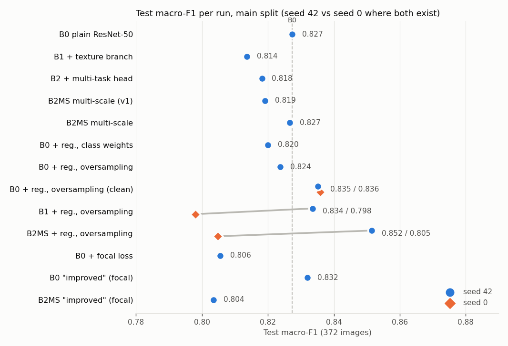

# waste-clothing-classification

**Coursework project: sorting waste clothing into *reuse / recycle / dispose* from a single photo, with Grad-CAM / LayerCAM used to check where the model looks.**
A ResNet-50 baseline was extended step by step (texture branch, auxiliary head, multi-scale texture branch). Class imbalance was handled with class-weighted loss, oversampling and focal loss. The class-activation maps were scored against the dataset's stain/damage bounding boxes.

The main lesson was negative. On a 372-image test set, none of the architectural changes beat the plain ResNet-50 by more than the spread between two random seeds. The activation maps showed that the models rarely focus on the actual defect.



## Task and data

* **Dataset:** AI-Hub *폐의류 재활용 분류 및 선별 데이터* ("Waste clothing recycling classification and sorting data"), from [AI-Hub](https://www.aihub.or.kr) (Korea). The data is **not included** in this repo, and no dataset images are. Access requires applying on AI-Hub, and redistribution is governed by AI-Hub's terms.
* **Subset used:** blouse images only. Labels come from each JSON's `big_category` (`reusable` / `recycle` / `dispose`). The JSONs also contain `pollution` and `damage` boxes, which are used only for the localization evaluation.
* **Main split** (`splits/`, file names only, stratified, seed 42): 2,477 images → train 1,733 / val 372 / test 372.
  Test = 129 reuse, 178 recycle, 65 dispose.
* In this subset the box types follow the class: every *dispose* image has a pollution box, every *recycle* image a damage box, and *reuse* images have none. The localization evaluation therefore covers 243 test images (recycle + dispose).

## Stages

All models use an ImageNet-pretrained ResNet-50 at 224×224, AdamW with a cosine schedule, AMP and label smoothing 0.05. Vertical flips are left out of augmentation on purpose (garments have a top and a bottom). The model is selected on validation macro-F1.

| Stage | What changed |
|---|---|
| **B0** | Plain ResNet-50, `fc` replaced by a 3-class head. Imbalance: class-weighted CE **and** `WeightedRandomSampler` |
| **B1** | + *texture branch*: a stride-1 3×3 conv path on the raw image, downsampled to the stem output (64 ch, H/4) and added with a learnable scale α (initialized to 0) |
| **B2 (multi-task)** | + auxiliary garment-type head, `L = L_main + 0.3·L_sub` |
| **B2MS (multi-scale)** | Texture branch with two parallel paths: *fine* 3×3 and *coarse* 3×3 with dilation 2 (5×5 receptive field). They are concatenated, batch-normalized and downsampled to the stem like B1 (`MultiScaleTextureBlock`) |
| **Regularization round** | dropout 0.3, weight decay 1e-3, early stopping (patience 4). Imbalance handled by class weights *or* offline oversampling of the minority classes inside the training split *or* focal loss (γ = 2, class-weight α) |
| **"Improved"** | focal loss (γ = 2) + dropout 0.3 + random erasing, 15 epochs. A dispose-class probability threshold is tuned on the validation set |
| **B4 (XAI)** | Grad-CAM on `layer4` (implemented with hooks), CAM → box by threshold + largest connected component. Follow-up: Grad-CAM, Grad-CAM++ and LayerCAM on `layer3` / `layer4` / both, with a threshold sweep |

## Results

All numbers are copied from each run's saved `test_metrics.json` (`results/summary.csv`). Each run's config was read back from its checkpoint and saved in `results/runs/<run>/config.json`. Test set = the 372-image main split.

| Run | Imbalance handling | Seed | Test acc. | Test macro-F1 |
|---|---|---|---|---|
| B0 plain ResNet-50 | class-weighted CE + sampler | 42 | 0.866 | 0.827 |
| B1 + texture branch | class-weighted CE + sampler | 42 | 0.849 | 0.814 |
| B2 + multi-task head | class-weighted CE + sampler | 42 | 0.860 | 0.818 |
| B2MS multi-scale, v1 (same recipe as B1) | class-weighted CE + sampler | 42 | 0.866 | 0.819 |
| B2MS multi-scale, re-tuned (lr 3e-5, wd 2e-3, light aug.) | class-weighted CE (power 0.75) | 42 | 0.866 | 0.827 |
| B0 + reg. | class weights only | 42 | 0.852 | 0.820 |
| B0 + reg. | oversampling | 42 | 0.866 | 0.824 |
| B0 + reg. ("clean" re-run) | oversampling | 42 / 0 | 0.860 / 0.866 | 0.835 / 0.836 |
| B1 + reg. | oversampling | 42 / 0 | 0.876 / 0.855 | 0.834 / 0.798 |
| B2MS + reg. | oversampling | 42 / 0 | 0.879 / 0.863 | 0.852 / 0.805 |
| B0 + reg. | **focal loss**, no oversampling | 42 | 0.836 | 0.806 |
| B0 "improved" | focal loss + random erasing | 42 | 0.871 | 0.832 |
| B2MS "improved" | focal loss + random erasing | 42 | 0.841 | 0.804 |

* **Multi-scale:** B2MS matched B0 at best (0.827 vs 0.827). Its best single number (0.852) dropped to 0.805 with a different seed. Across the two seeds B0 is the most stable (0.835 / 0.836).
* **Focal loss:** none of the three focal-loss runs beat its oversampling counterpart. Tuning the dispose threshold on validation raised B0 "improved" from 0.832 to 0.844 test macro-F1 (`results/runs/B_improved/threshold_metrics.json`).

**Separate test set:** three runs were evaluated on images from AI-Hub's official *Validation* split (231 for model selection, 231 for test; no file names shared with the training images). Test macro-F1:

| Run | Test acc. | Test macro-F1 |
|---|---|---|
| B0 + reg. | 0.931 | 0.884 |
| B1 + reg. (texture branch) | 0.948 | **0.907** |
| B2MS + reg. (multi-scale) | 0.935 | 0.880 |

The single texture branch did best here, and the multi-scale branch did not beat B0. This is one seed, and the test set has only 27 *dispose* images, so the gaps may be noise.

### Localization (B4)

Grad-CAM for the ground-truth class on `layer4`, heatmap thresholded at 0.5 × max, 243 test images (`results/xai/B4_xai/`):

| Model (checkpoint) | Mean box IoU | Loc@0.5 (IoU ≥ 0.5) | Pointing game |
|---|---|---|---|
| B0 | 0.110 | 2.9 % | 28.0 % |
| B0 + reg., class weights | 0.126 | 4.1 % | 21.8 % |
| B1 | 0.096 | 2.1 % | 28.4 % |
| B2MS (v1 checkpoint) | 0.172 | 4.1 % | 42.0 % |
| B2MS "improved" | 0.083 | 0.8 % | 24.7 % |
| B0 "improved" | 0.027 | 1.2 % | 6.2 % |

The follow-up sweep (`results/xai/B4_xai_improved/`) tried Grad-CAM, Grad-CAM++ and LayerCAM on `layer3`, `layer4` and both, at several thresholds. For every model the best setting was **LayerCAM**, at a lower threshold (0.3):

| Model | Best method / layers | Box IoU | Pointing game |
|---|---|---|---|
| B0 | LayerCAM, layer3+4 | 0.193 | 32.5 % |
| B1 | LayerCAM, layer3+4 | 0.200 | 37.9 % |
| B2MS (v1 checkpoint) | LayerCAM, layer3+4 | 0.225 | 46.1 % |
| B2MS "improved" | LayerCAM, layer3 | 0.188 | 35.4 % |
| B0 "improved" | LayerCAM, layer3 | 0.059 | 9.5 % |

For B0 and B1, LayerCAM raises box IoU from about 0.10 (plain `layer4` Grad-CAM) to about 0.20. The method, layers and threshold were picked on the same test images, so these numbers are optimistic. Even the best model places fewer than 1 in 10 boxes at IoU ≥ 0.5.

## Run → notebook

Each run in `results/` and the notebook that produced it. The notebook's Config matches the config saved in the checkpoint. The test metrics printed in the original notebook output match `test_metrics.json`.

| Results folder | Notebook |
|---|---|
| `baseline_resnet50` (B0) | `notebooks/1_stages/baseline_B0_local.ipynb` |
| `baseline_B1_texture` | `notebooks/1_stages/baseline_B1_local.ipynb` |
| `baseline_B2_multitask` | `notebooks/1_stages/baseline_B2_local.ipynb` |
| `baseline_B2_multiscale_v1` | `notebooks/1_stages/baseline_B2_multiscale_local_v1.ipynb` ¹ |
| `baseline_B2_multiscale` | `notebooks/1_stages/baseline_B2_multiscale_local.ipynb` |
| `baseline_resnet50_tuned` | `notebooks/2_imbalance/baseline_B0_tuned.ipynb` |
| `baseline_resnet50_oversample` | `notebooks/2_imbalance/baseline_B0_oversample_fixed.ipynb` |
| `baseline_B0_clean`, `…_seed0` | `notebooks/2_imbalance/baseline_B0_clean.ipynb` ² |
| `baseline_B1_texture_clean`, `…_seed0` | `notebooks/2_imbalance/baseline_B1_texture_clean.ipynb` ² |
| `baseline_B2_multiscale_clean`, `…_seed0` | `notebooks/2_imbalance/baseline_B2_multiscale_clean.ipynb` ² |
| `baseline_B0_focal` | `notebooks/2_imbalance/baseline_B0_focal.ipynb` |
| `B_improved` | `notebooks/2_imbalance/baseline_B_improved_local.ipynb` |
| `B2MS_improved` | `notebooks/2_imbalance/baseline_B2MS_improved_local.ipynb` |
| `baseline_B0_offval`, `baseline_B1_texture_offval`, `baseline_B2_multiscale_offval` | `notebooks/3_official_val/` (same names) |
| `xai/B4_xai/{B0,B1,B2MS,IMPROVED,B2MS_IMP}` | `notebooks/4_xai/baseline_B4_local.ipynb` (set `MODEL_VARIANT`) |
| `xai/B4_xai/B0_tuned` | `notebooks/4_xai/baseline_B4_oversample.ipynb` ³ |
| `xai/B4_xai_improved/*` | `notebooks/4_xai/baseline_B4_local_improved.ipynb` |

¹ The first version of the B2MS notebook, with B1's recipe. Its results (`baseline_B2_multiscale_v1`) were restored from the archived run folder. Both B2MS rows in the localization tables were computed on **this** checkpoint, before the re-tuned B2MS run replaced it.
² These notebooks are saved with `seed = 0`, and they append `_seed<k>` to the output folder. The seed-42 runs used the same notebook before that suffix was added; set `seed = 42` to reproduce them.
³ This notebook overrides the checkpoint path. As saved, it evaluates `baseline_resnet50_tuned`.

**Excluded on purpose:**
* `baseline_*_oversample_extra` and `baseline_*_texture/multiscale_oversample` (0.89–0.94 macro-F1). They added a second copy of all 438 *dispose* images to training, including all 65 test *dispose* images byte for byte, so their test scores are leaked and **must not be quoted**. These notebooks and results are not in the repo.
* Localization results computed on those leaked models (an IoU/pointing comparison across Grad-CAM, Grad-CAM++ and LayerCAM, and a Grad-CAM comparison grid).
* A Grad-CAM run labelled `B0_oversample`. It was computed on an earlier `baseline_resnet50_oversample` checkpoint that was later found to be leaked and re-trained (`…_oversample_fixed`).

## What I learned

1. **Seed variance can be larger than the effect being measured.** I first read B2MS + oversampling (0.852) as a clear win. Re-running with another seed gave 0.805. With a 65-image minority class, a few images move macro-F1 by several points. Comparisons like this need several seeds, or at least a confidence interval.
2. **Check splits for duplicates before trusting a jump.** Adding 438 "extra" *dispose* images to training raised macro-F1 to 0.89–0.94. When I checked, the extra set was a second copy of the dispose images and contained all 65 test *dispose* images. The fix (`baseline_B0_oversample_fixed`) oversamples only inside the training split.
3. **Good accuracy ≠ looking at the defect.** Even the best model puts its activation peak inside a stain/damage box less than half the time. In the Grad-CAM examples I inspected, many misses peak on the same top-left background area. The classifier may be using cues other than the defect itself, which accuracy alone would not have shown me.
4. **The explanation method matters as much as the model.** Switching from `layer4` Grad-CAM to LayerCAM changed box IoU more than any architecture change did. Localization numbers are only comparable at a fixed method, layer and threshold.
5. **Focal loss is not a free fix for imbalance.** No run with focal loss scored higher than the comparable run with oversampling and plain CE.

## Limitations

* Single garment type (blouse), a ~2.5k-image subset and a 372-image test set; at most two seeds per configuration.
* The B2 multi-task head is degenerate on this subset: there is only one garment type, so the auxiliary task is trivial (sub-task accuracy 1.0).
* The stain/damage boxes mark *where a defect is*, not necessarily what decides the label, and they exist only for recycle/dispose images. No random-point baseline was computed for the pointing game.
* In the B4 notebooks, `among_correct` is computed with the ground-truth class as the prediction when `cam_class='gt'`, so it always equals the overall score. It is not reported here.
* The notebooks are the versions that were run, with outputs stripped and paths made configurable. Comments and markdown inside them are in Korean.

## Repository layout

```
notebooks/1_stages/        B0, B1 (texture), B2 (multi-task), B2MS (multi-scale, v1 and re-tuned)
notebooks/2_imbalance/     class weights / oversampling / focal loss / "improved" runs
notebooks/3_official_val/  runs evaluated on the official AI-Hub validation split
notebooks/4_xai/           Grad-CAM and LayerCAM localization (box IoU, Loc@0.5, pointing game)
splits/                    train/val/test file names of the main split (no images)
results/summary.csv        test accuracy / macro-F1 for every run
results/runs/<run>/        config.json (from the checkpoint), test_metrics.json, efficiency.json, history.csv
results/xai/               localization metrics per model
```

## Run

```bash
pip install -r requirements.txt
```

1. Download the dataset from AI-Hub. Put the blouse images and JSON labels under `data/blouse/` and, for `3_official_val`, the official validation data under `data/aihub_official/`. Any folder layout works; the manifest builder searches recursively.
2. Each notebook's first cell sets `DATA_ROOT` (default `../../data`) and `RUNS_ROOT` (default `../../runs`). Override them with environment variables if needed.
3. Run `notebooks/1_stages/baseline_B0_local.ipynb` first. It writes the split to `runs/_split/`, which every other notebook reuses. Then run any other stage.
4. The `4_xai` notebooks load checkpoints from `runs/<run>/best.pt`. Pick the model with `MODEL_VARIANT`.

A CUDA GPU is assumed. Checkpoints are not included.
